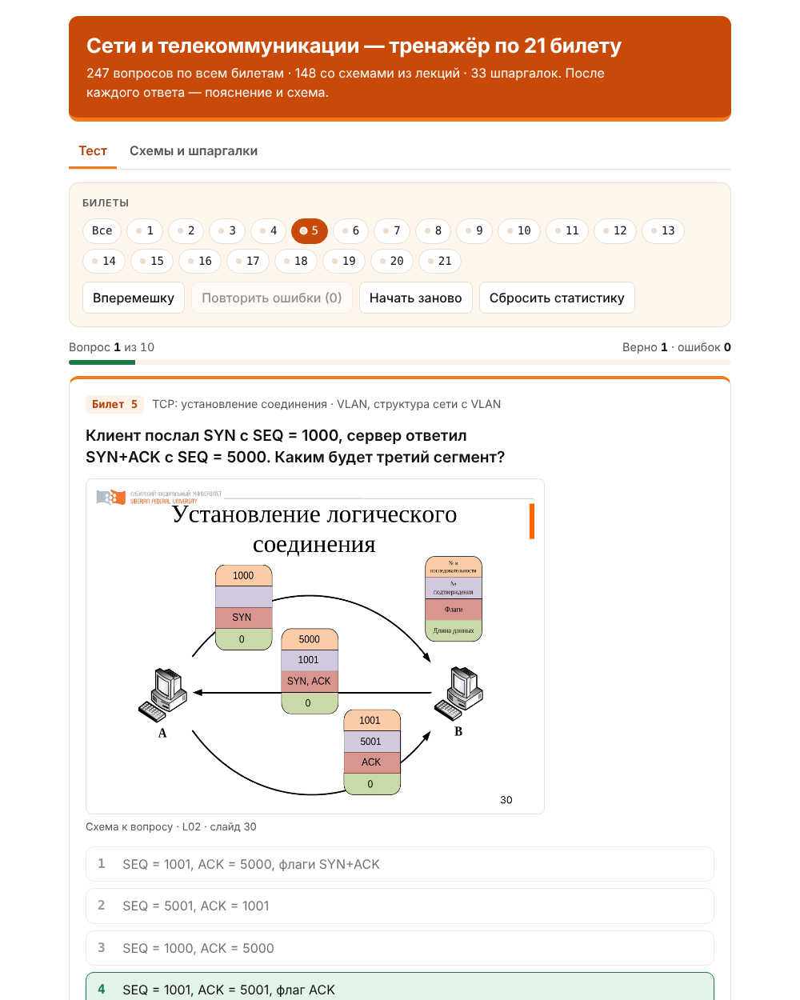

# Сети: тренажёр по 21 билету

Тренажёр к экзамену по «Сетям и телекоммуникациям» (Шмелева О.В.). 247 вопросов по всем 21 билету, от модели OSI до IPsec и NAT. Больше чем в половине вопросов есть слайд из лекции, а часть нужно решать прямо по схеме: какой порт заблокирует STP, какой путь найдёт Дейкстра, какой адрес увидит сервер после NAT.

Сайт: https://ktoblyachtoblyayablya.github.io/network-exam-trainer/



## Что внутри

- Все вопросы подряд, один билет или несколько выбранных.
- После ответа показываются пояснение, слайд и шпаргалка: обмен TCP и DHCP, состояния STP и OSPF, тег 802.1Q, таймеры, AD, порты, ACL.
- «Повторить ошибки» оставляет только вопросы, на которые в последний раз ответили неверно. Цветная точка на кнопке билета показывает, как он идёт.
- Вкладка «Схемы и шпаргалки», чтобы пролистать всё по билетам перед экзаменом.
- Клавиши 1–4 и Enter, увеличение схем по клику, светлая и тёмная тема. Прогресс хранится в браузере, сервер не нужен.

## Запуск

Открыть `index.html` в браузере или поднять сервер: `python3 -m http.server 8000`.

## Как добавить или исправить вопрос

Вопросы лежат в `data/questions/ticket-NN.js`, по файлу на билет, шпаргалки — в `data/cards.js`. Один вопрос — одна строка:

```js
{t:5, q:"Сколько сегментов в установлении TCP-соединения?",
 o:["3","2","4","1"],
 e:"Трёхэтапное рукопожатие: SYN → SYN+ACK → ACK.",
 f:"L02_p30", fb:1, c:"tcp"}
```

`t` — номер билета, `q` — вопрос, `o` — варианты (первый правильный, на странице они перемешиваются), `e` — пояснение. Необязательные поля: `f` — слайд из `img/slides` без `.png`, `fb: 1` — показать слайд вместе с вопросом, `c` — шпаргалка.

После правок запустите `node tools/validate.js` (нужен Node.js 18+). Он найдёт пустые поля, повторы и ссылки на несуществующие слайды и шпаргалки. Та же проверка идёт в GitHub Actions при каждом пуше и пулл-реквесте.

## Ошибки в слайдах лекций

На трёх слайдах есть ошибки, в тренажёре они учтены:

- Л16, слайд 4: параметры 802.11a и 802.11b перепутаны. На самом деле 802.11a — 5 ГГц и 54 Мбит/с, 802.11b — 2,4 ГГц и 11 Мбит/с.
- Л14, слайд 16: в настройке PPTP-сервера написано `protocol pppoe`, а должно быть `protocol pptp`.
- Л16, слайд 20: RTS/CTS описан в разделе про PCF, хотя это опция режима DCF.

## Слайды и права

Слайды в `img/slides` — это страницы лекций курса «Сети и телекоммуникации» (Шмелева О.В.), а не часть кода проекта. Скажут удалить — удалю, пока пиратим. Надеюсь не числанут за такое не целевое использование лекций, так что чуваки не пакостите, пжпж.

## Лицензия

Copyright (C) 2026 Пантелеев Г.Д. Код, вопросы и шпаргалки распространяются под [GPL-3.0-or-later](LICENSE). На слайды лекций лицензия не распространяется.
