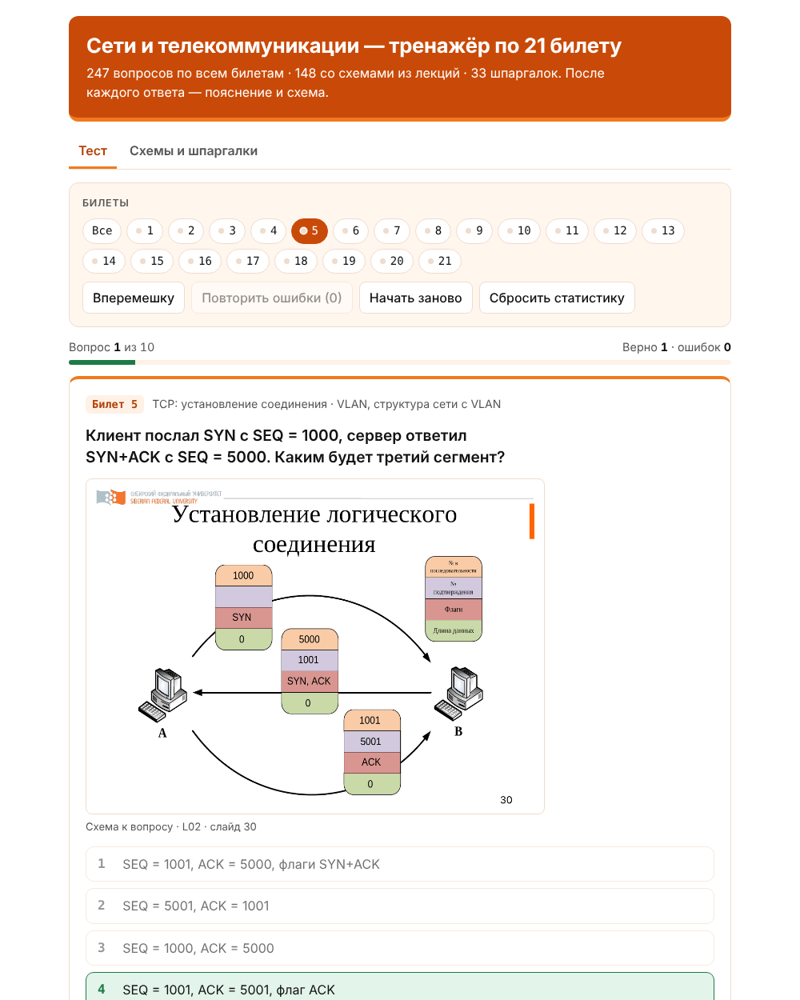

# Тренажёр по сетям: 21 билет

Тренажёр для подготовки к экзамену по курсу «Сети и телекоммуникации»: 247 вопросов по всем 21 билету, слайды из лекций и 33 шпаргалки-схемы. После каждого ответа показываются пояснение, слайд и шпаргалка по теме, так что во время теста материал заодно и запоминается.



## Возможности

- **Вопросы по всем билетам.** От модели OSI до IPsec и NAT. В 148 вопросах есть слайд из лекции, а 83 вопроса нужно решать прямо по схеме: какой порт заблокирует STP, какой путь найдёт Дейкстра, какой адрес увидит сервер после NAT.
- **Разбор после ответа.** Пояснение, слайд и шпаргалка: диаграммы обмена TCP и DHCP, цепочки состояний STP и OSPF, разбор тега 802.1Q, таблицы таймеров, AD, портов, ACL.
- **Выбор билетов.** Можно проходить все вопросы, один билет или несколько выбранных.
- **Работа над ошибками.** Кнопка «Повторить ошибки» оставляет только вопросы, на которые последний раз ответили неверно. Цветная точка на кнопке билета показывает его состояние.
- **Вкладка «Схемы и шпаргалки».** Все слайды и шпаргалки разложены по билетам, удобно пролистать перед ответом.
- **Удобство.** Варианты ответа перемешиваются при каждом показе. Есть клавиши (1–4 — ответ, Enter — дальше), увеличение схем по клику. Светлая тема — белая с оранжевым, тёмная — тёмная с оранжевым, выбирается по настройке системы.
- **Без сервера и сборки.** Статистика хранится в браузере (localStorage), на сервер ничего не отправляется.

## Запуск

Откройте `index.html` в браузере — сборка и сервер не нужны.

Или запустите локальный сервер:

```bash
python3 -m http.server 8000
# открыть http://localhost:8000
```

## Структура

```
index.html                  разметка, подключение скриптов
css/style.css               стили: светлая и тёмная темы с оранжевым акцентом
js/helpers.js               Q, C и функции для рисования шпаргалок
js/app.js                   логика тренажёра
data/tickets.js             темы билетов
data/cards.js               шпаргалки
data/questions/ticket-NN.js вопросы, по файлу на билет
img/slides/                 слайды из лекций (KEY.png, например L02_p30.png)
tools/validate.js           проверка банка вопросов
docs/screenshot.png         картинка для README
```

## Как добавить или исправить вопрос

Вопросы лежат в `data/questions/ticket-NN.js`. Каждый вопрос — одна строка:

```js
{t:5, q:"Сколько сегментов в установлении TCP-соединения?",
 o:["3","2","4","1"],
 e:"Трёхэтапное рукопожатие: SYN → SYN+ACK → ACK.",
 f:"L02_p30", fb:1, c:"tcp"}
```

| Поле | Что значит |
|------|------------|
| `t`  | номер билета |
| `q`  | текст вопроса |
| `o`  | варианты ответа; **первый — правильный**, на странице они перемешиваются |
| `e`  | пояснение, которое показывается после ответа |
| `f`  | необязательно: слайд из `img/slides` без `.png` |
| `fb` | необязательно: `1` — показать слайд вместе с вопросом, иначе он показывается после ответа |
| `c`  | необязательно: ключ шпаргалки из `data/cards.js` |

После правок запустите проверку (нужен Node.js 18+):

```bash
node tools/validate.js   # или npm run check
```

Скрипт найдёт пустые поля, повторы, несуществующие слайды и шпаргалки. Тот же скрипт запускается в GitHub Actions на каждый push и pull request.

Шпаргалки собираются из функций `tbl` (таблица), `chain` (цепочка шагов), `seq` (диаграмма обмена двух сторон), `bits` (поля заголовка) и `note` (абзац) — примеры есть в `data/cards.js`.

## Неточности в слайдах лекций

В тренажёре учтено, что на трёх слайдах есть ошибки:

- **Л16, слайд 4.** Параметры 802.11a и 802.11b переставлены. На самом деле 802.11a — 5 ГГц и 54 Мбит/с, 802.11b — 2,4 ГГц и 11 Мбит/с.
- **Л14, слайд 16.** В настройке PPTP-сервера написано `protocol pppoe`, правильно `protocol pptp`.
- **Л16, слайд 20.** Механизм RTS/CTS описан в разделе про PCF, хотя это опция режима DCF.

## Слайды и права

Слайды в `img/slides` — это страницы лекций курса «Сети и телекоммуникации» (Шмелева О.В.), а не часть кода проекта. Скажут удалить — удалю, пока пиратим. Надеюсь не числанут за такое не целевое использование лекций, так что чуваки не пакостите, пжпж.

## Автор

Пантелеев Г.Д. Тренажёр сделан на основе материалов курса «Сети и телекоммуникации» (Шмелева О.В.).

## Лицензия

Copyright (C) 2026 Пантелеев Г.Д.

Код, вопросы и шпаргалки распространяются под лицензией [GNU GPL версии 3](LICENSE) или (на ваш выбор) любой более поздней версии (`GPL-3.0-or-later`). Проект можно свободно использовать, изменять и распространять. Условия такие: изменённые версии тоже должны выходить под GPL с открытым исходным кодом, а указание авторства и текст лицензии нужно сохранять.

Проект предоставляется «как есть», без каких-либо гарантий.

Лицензия не распространяется на слайды лекций в `img/slides`: права на них принадлежат их авторам.
